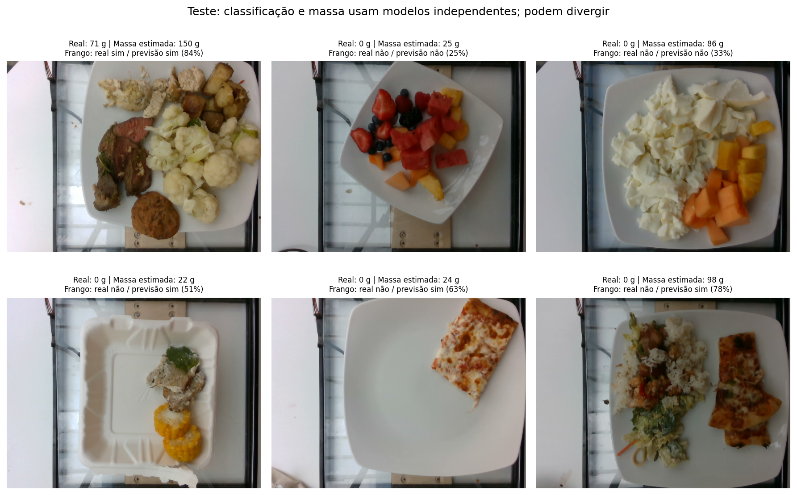
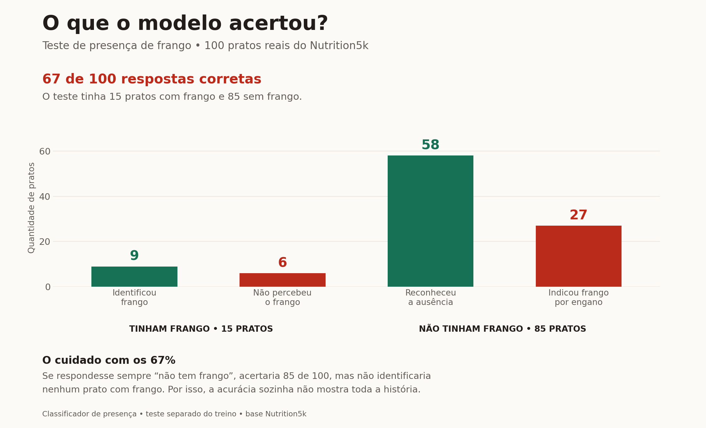
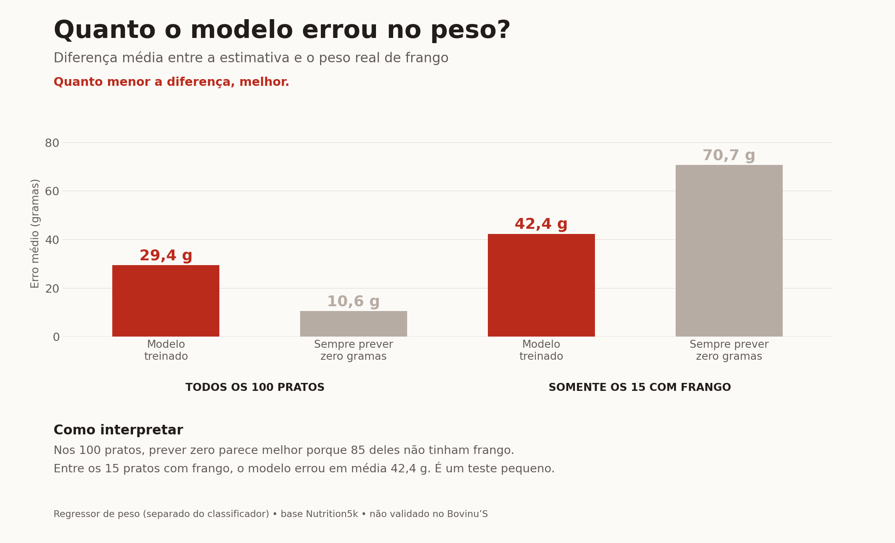

**Hackathon FMU Tech 2026.2 · Protótipo de análise do prato servido**

Quanto do peso de um prato por quilo corresponde a frango? Essa informação pode ajudar a equipe do Bovinu’S a entender a composição dos pratos, uma das dores apresentadas para a unidade Augusta. Nosso projeto é uma **prova de conceito** que experimenta estimar a presença e a quantidade de frango a partir da foto do prato e do peso total da comida.

> **Status:** experimento inicial. Os resultados ainda têm erro elevado e **não servem para decisões operacionais ou financeiras**. A foto é enviada e o peso informado no aplicativo; não há câmera ou balança conectada no protótipo.

## Slides do protótipo do projeto

[Ver a apresentação do Mix do Prato (PDF)](apresentacao-mix-do-prato.pdf)


## Problema e proposta

No almoço por quilo, o cliente se serve, pesa o prato e escolhe uma mesa. A balança informa o peso total da comida, mas não separa os alimentos que compõem esse peso. Como alimentos diferentes têm custos diferentes, conhecer o mix dos pratos pode apoiar futuras análises do restaurante.

Nossa proposta é investigar se um modelo de aprendizado de máquina, alimentado por uma foto e pelo peso total, consegue estimar a composição automaticamente. A demonstração está limitada a **frango**, e usa imagens do conjunto de pesquisa Nutrition5k, não imagens do Bovinu’S.

**O projeto não mede desperdício no prato.** Para saber o que o cliente deixou, seria necessário medir também as sobras, em uma etapa futura.

## Demonstração

Na aplicação, escolha uma amostra disponível ou envie uma foto, informe o peso líquido da comida em gramas e veja as saídas do experimento. O sistema apresenta uma classificação de presença e uma estimativa de massa para frango. Essas saídas vêm de **dois modelos independentes e podem discordar**. A pontuação apresentada pelo classificador não é uma probabilidade calibrada.



## Slides do protótipo do projeto

 


## Vídeo da demonstração 

[Assistir ao Mix do Prato em funcionamento](https://youtu.be/N_XuUvVgNXM)


O [notebook de treinamento](projeto_mix_prato/treinamento/experimento_colab.ipynb) e o [script equivalente](projeto_mix_prato/treinamento/treinar_e_avaliar.py) mostram como o experimento foi feito. Reexecutá-los exige baixar uma amostra do Nutrition5k.

## Experimente o protótipo

[Abrir o Mix do Prato](https://matheuspelegrinim-blip.github.io/mix-do-prato-bovinus/)

## Como funciona

1. A pessoa envia a **foto do prato** e informa o **peso líquido total** da comida.
2. O programa cria uma representação simplificada da imagem, incluindo uma miniatura e histogramas de cor, e incorpora o peso total.
3. Um modelo de classificação estima a presença de frango; um modelo de regressão estima a fração de frango e a converte em gramas.
4. A aplicação mostra as duas saídas e, para amostras do conjunto de teste com referência conhecida, permite compará-las com os valores registrados.

Os dois modelos usam **Random Forest**, implementado com scikit-learn. Não há segmentação por alimento: o protótipo não desenha onde está o frango, não mede diretamente cada ingrediente e não faz leitura automática da balança.

## Desenvolvimento e avaliação

Usamos fotografias reais e pesos por ingrediente do [Nutrition5k](https://github.com/google-research-datasets/Nutrition5k), com os IDs de treino e teste da divisão oficial para imagens superiores:

- **Treino:** 300 pratos, sendo 150 com e 150 sem frango, selecionados de forma balanceada.
- **Teste:** 100 pratos separados, dos quais 15 tinham frango e 85 não tinham.
- O rótulo de frango foi limitado a cinco nomes exatos presentes na base: `chicken`, `chicken thighs`, `chicken breast`, `grilled chicken` e `roast chicken`. Preparações misturadas com outros nomes, como salada ou linguiça de frango, foram excluídas da seleção.

| Indicador na amostra de teste | Resultado |
| --- | --- |
| Acurácia da classificação de presença | 67% |
| Pratos com frango identificados | 9 de 15 |
| Pratos sem frango indicados incorretamente como com frango | 27 de 85 |
| Erro absoluto médio da estimativa de massa | 29,4 g nos 100 pratos |
| Comparação: sempre prever 0 g | 10,6 g de erro médio nos mesmos 100 pratos |

A regra de sempre dizer “sem frango” também teria **85% de acurácia** nesse teste, mas não identificaria nenhum dos 15 pratos com frango. Isso evidencia o desbalanceamento da amostra e mostra que a acurácia isolada não significa que o sistema funciona bem.

Entre os 15 pratos com frango, o erro médio da estimativa foi de **42,4 g**. Uma estimativa pode tanto ficar acima quanto abaixo do valor real. Os resultados dizem respeito apenas a essa amostra e não estabelecem desempenho no Bovinu’S.

### Resultados em gráficos

Os gráficos ajudam a visualizar os resultados do primeiro modelo nos 100 pratos reservados para teste. As duas tarefas usam modelos independentes: uma identifica a presença de frango e a outra estima a quantidade em gramas.





Os dados são do Nutrition5k; o modelo ainda não foi validado no Bovinu’S.

## Executar localmente

Requisitos: Python 3.11 ou superior, `pip` e um navegador. A instalação baixa as bibliotecas indicadas no projeto.

```bash
python -m venv .venv
```

Ative o ambiente virtual:

```bash
# macOS / Linux
source .venv/bin/activate

# Windows PowerShell
.venv\Scripts\Activate.ps1
```

Instale as dependências e inicie a aplicação:

```bash
python -m pip install -r requirements.txt
python app.py
```

Abra **http://127.0.0.1:8000** no navegador. O peso informado deve corresponder apenas à comida, descontando o prato e a embalagem. As fotos enviadas para a demonstração não são mantidas pelo servidor.

## Limitações e próximos passos

- O modelo apresentou muitos falsos positivos e ainda não é confiável para implantação.
- A base foi coletada em cafeterias dos Estados Unidos; pratos, iluminação, câmera e alimentos podem diferir do Bovinu’S.
- Uma próxima etapa seria reunir imagens e pesos de referência de amostras controladas do restaurante, com os alimentos pesados para calibração. Isso **não exigiria pesar cada ingrediente de todos os clientes durante a operação**.
- Poderíamos investigar segmentação de alimentos e informações de profundidade. Uma máscara na foto não é, por si só, uma medição em gramas.
- Em um piloto futuro, seria preciso verificar se a balança atual permite integração e se a captura ocorre sem aumentar a fila, além de testar o modelo em pratos separados do treino.

## Fontes e créditos

- **Dados:** Nutrition5k, disponibilizado por Google Research, com licença Creative Commons Attribution 4.0. Autores: Thames, Karpur, Norris, Xia, Panait, Weyand e Sim (CVPR 2021). [Repositório e referência](https://github.com/google-research-datasets/Nutrition5k).
- **Código e interface:** desenvolvidos para esta prova de conceito do Hackathon FMU Tech 2026.2. As bibliotecas utilizadas possuem suas próprias licenças.
- Os valores do estudo e as imagens de exemplo são do Nutrition5k; nenhum resultado foi medido no Bovinu’S.
